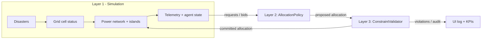

# Trojan — Project Description

Version 0.1 · 2026-11-14 · Status: **Phases 1–3 built** (simulation, negotiation, safety, with the prosumer microgrid); Phase 4 (evaluation) future, headless bench exists.

Companion documents: `PRD.md` (requirements and acceptance criteria), `SPEC.md` (technical source of truth —
this document references it and does not duplicate its tables), `DESIGN.md` (UI and scene look),
`docs/MODEL_BRIEF.md` (3D component rules).

---

## 1. Vision

When a disaster hits a city, the power that remains is a scarce, shared resource, but the organisations that
depend on it behave as if they were alone. **Trojan** is a platform for *autonomous multi-agent negotiation
for crisis resource allocation*: every city utility (hospital, water pumping station, emergency service,
telecom tower, shelter, household cluster) is represented by its own software agent. During a disaster those
agents negotiate in real time, through bids, priorities and concessions, over a fluctuating power supply, so
that the limited electricity goes where it prevents the most harm, without ever breaking a physical limit.

The long-term vision is a system whose allocations are (a) **adaptive**, because they come from negotiation
and not a fixed rule table, (b) **fair**, because priority is balanced against fairness over time, and
(c) **safe**, because an independent safety layer can veto anything that violates a hard limit.

Trojan is built simulation-first. Before any agent negotiates, there must be a believable city, a real power
network, real disasters and live telemetry for the agents to sense. That simulation (Layer 1) was built first; Layers 2 and 3 now run on top of it.

## 2. The problem

> City utilities such as hospitals, water pumping, emergency services and telecom usually run independently
> during disasters, so limited power gets used poorly and failures cascade. Build a decentralized system
> where an autonomous agent represents each utility. The agents negotiate in real time, through bids,
> priorities and concessions, over a fluctuating power supply. Every allocation must respect hard capacity
> limits, avoid inconsistent states, balance priority against fairness, and minimize total damage across a
> simulated multi-hour disaster scenario.

### 2.1 Why it matters

| Failure mode | What happens today | Consequence |
|---|---|---|
| **Siloed utilities** | Each operator optimises its own continuity; nobody sees the whole-city picture. | Non-critical load keeps drawing power while a hospital or pump station is starved. |
| **Static priority lists** | Load-shedding follows pre-written tables that cannot react to *who needs power right now* (a hospital with a surge of incoming patients, a reservoir that is nearly empty, a tower whose battery is dying). | Priority is right on paper and wrong in the moment. |
| **Cascading failures** | One loss shifts flow onto surviving lines; they overload and trip; their loads shift again. | A local fault becomes a regional blackout. Telecom loss blinds emergency dispatch; pump loss removes water pressure for fire-fighting; hospitals lose ventilators. |
| **Cross-sector dependencies** | Water needs power, telecom needs power, emergency response needs telecom, hospitals need water. | Failures propagate *between* sectors, not just along wires. |
| **Fluctuating supply** | Generators trip, solar output falls with dusk and cloud, islands form when lines break. | The amount to share changes minute by minute; a plan made at t=0 is stale at t=30. |

The cost is measured in harm: patients without ventilation, unserved emergency calls, loss of safe water,
loss of communication. Trojan exists to make that harm measurable and then minimise it.

## 3. Solution overview

Three layers, built in order, each usable on its own:

```
┌───────────────────────────────────────────────────────────────────────────┐
│  LAYER 3 — SAFETY                                       (Phase 3, built)   │
│  ConstraintValidator: hard limits · physics · minSafe · fairness bound ·   │
│  atomic commit · invariants · audit log.  Can VETO any allocation.         │
├───────────────────────────────────────────────────────────────────────────┤
│  LAYER 2 — NEGOTIATION, BIDDING & PRIORITISATION        (Phase 2, built)   │
│  AllocationPolicy: utility agents bid with virtual tokens; dynamic         │
│  priority score; counter-offers, concessions, forward contracts.           │
├───────────────────────────────────────────────────────────────────────────┤
│  LAYER 1 — SIMULATION                                   (Phase 1, built)   │
│  3D city on a 48×48 grid · buildings & utilities · power network (lines,   │
│  pylons, poles) · disasters on grid blocks · live telemetry · clock/KPIs.  │
└───────────────────────────────────────────────────────────────────────────┘
        data flows up (snapshots, telemetry, requests)
        decisions flow down (allocations: policy → validator → engine)
```



The seams between layers are already fixed in code as two interfaces on the engine, `AllocationPolicy` and
`ConstraintValidator` (SPEC §7). Phase 1 ships simple baseline implementations (SPEC §7.2) so the system
runs end to end and so later layers have something to be measured against.

## 4. The three layers

### 4.1 Layer 1 — Simulation (base; built)

A complete, deterministic, pure-TypeScript model of a city under disaster, plus a 3D interface to watch and
poke it. See SPEC §2–§9.

| Element | Summary | SPEC |
|---|---|---|
| World | 48 × 48 grid of 12 m cells (576 m square), 5×5-cell blocks separated by roads, a meandering river with bridges, parks, elevation. | §2, §3 |
| Buildings | Houses, mobile towers (telecom), substations (electric distributors), generators (thermal / solar+battery), hospitals, emergency wards, schools (shelters), water supply systems. | §3.2 |
| Power network | Generator → transmission (pylons, ring) → substations → distribution (poles along roads) → service drops. Edges have capacity; islands form when parts break. | §4 |
| Disasters | Earthquake, flood, cyclone, fire, grid fault. Each writes **cell status**; any utility on a non-`ok` cell is fully off. | §7.3 |
| Agents & telemetry | Every consumer has a utility agent that *senses and reports* (patients, reservoir level, call load…) and computes derived bid fields. | §6 |
| Engine | One simulated minute per step; scenario is 24 h starting 10:00 local; speeds 1–60 sim-min per real second. | §7 |
| 3D view and UI | Toon-shaded city, animated power flow, disaster FX, inspector, KPIs, event log. | §8, §9 |

### 4.2 Layer 2 — Negotiation, bidding & prioritisation (built)

The decision layer. It is **not a pre-made rules layer**: priority and outcomes emerge from each round of
bids, counter-offers and concessions given current telemetry. Priority is need-based; virtual tokens are a **secondary cooperation signal, never a priority currency and never real money**.

- Each agent submits a **bid** derived from its power requirement, criticality, urgency, expected damage from
  power loss, and minimum safe power requirement.
- A **dynamic priority score** ranks bids and adapts with the crisis phase and with how recently each agent
  was served (fairness over time).
- **Virtual negotiation tokens** let agents make concessions (accept less, shed or defer load), earn credit
  for doing so, and negotiate **future** allocations through forward contracts.
- The **negotiation engine** evaluates bids, counter-offers and compromises in bounded rounds per simulated
  minute, then hands a proposed allocation to the validator.
- It consumes **live telemetry** from each utility: houses (demand, demand for emergency resources),
  hospitals (patients now, patients incoming, growth rate per hour, proximity to affected areas), and so on
  (SPEC §6.2).

Build spec: `docs/NEGOTIATION.md`. Summary: SPEC §10. Requirements: PRD FR-2.x.

### 4.3 Layer 3 — Safety (built)

The guard rail. It ensures that negotiation can never bypass hard limits, that allocations respect physics
(power balance, line and transformer capacity, backup energy) and that no inconsistent state is ever
committed. It runs after every allocation and has **veto power**. It also provides the guarantees the
problem statement asks for: critical services get their minimum safe power if physically possible, fairness
is bounded, and every decision is auditable.

Build spec: `docs/NEGOTIATION.md` §6. Summary: SPEC §11. Requirements: PRD FR-3.x.

## 5. The agents and what each senses

Each consumer building is a **utility agent** (SPEC §6). In Phase 1 agents only sensed and reported; from Phase 2 they bid and negotiate. Static profile values (base demand, minSafe fraction, criticality, backup, damage
rate) are in SPEC §6.1 and are not repeated here.

| Agent | Represents | Senses (live telemetry — keys in SPEC §6.2) | What drives its urgency |
|---|---|---|---|
| **Hospital** | 3 hospitals | Patients, ICU patients vs ICU beds, incoming patients/h, inflow growth %/h, ventilators in use, active surgeries, distance to impact, backup fuel hours, oxygen hours | ICU occupancy, fuel running low, inflow growth |
| **Emergency ward** | 3 fire & rescue / ambulance stations | Active incidents, units deployed/available, calls/h, average response time, distance to impact | Incident load, degraded roads |
| **Water supply** | 3 pump stations | Flow, reservoir %, pressure, pumps running, population served, contamination risk | Empty reservoir, flooding nearby |
| **Telecom** | 8 mobile towers | Active connections, load %, emergency calls/min, battery %, coverage, backhaul status | Load surge, battery depletion |
| **School (shelter)** | 4 schools | Sheltered people, capacity, inflow/h, medical cases, water | Evacuee inflow, medical cases |
| **House** | many 1×1 homes (clusters in Phase 2) | Occupants, medical-device flag, battery %, emergency requests/h, evacuated flag | Medical device, battery exhaustion |
| *Substation / Generator* | Infrastructure, **not** consumers | Capacity, output, trip state, flow | Provide supply and routing; become negotiation constraints, not bidders |

Hospital, water, emergency, telecom and school agents are **Jev-driven**: each has its own perception from TypeSafe Jev and falls back to a deterministic heuristic when Jev is unavailable. Household agents are per-cluster (same feeder substation and 6×6 city block) and never call Jev. Only affected utilities negotiate actively; the others cooperate or stay idle.

All agents also sense `distanceToImpactM` (distance to the nearest non-`ok` cell). Every agent exposes the
derived bid fields `urgency`, `expectedDamagePerHour` and a token balance (initially 100 each; spent and earned from Phase 2).

## 6. The virtual token economy (Layer 2 concept)

Tokens are an internal bookkeeping device for expressing and trading *willingness to be served*. They have no
monetary value and never leave the simulation.

| Concept | Idea |
|---|---|
| **Endowment** | Every agent starts with an equal balance (100 in SPEC §6.3). Equal start means priority differences must come from need, not wealth. |
| **Spend (secondary)** | An agent may attach a bounded amount of tokens to a bid as a secondary signal of willingness. The tokens are escrowed and charged only if the agent wins phase-2 power. |
| **Earn by conceding** | Accepting less than requested, deferring load, shedding non-critical load or yielding to a more urgent agent earns tokens, proportional to the kW and duration conceded. |
| **Forward contracts** | "I give you 200 kW now; you return 150 kW in hour 3." Tokens back the promise and are forfeited on default; the validator checks that contracts stay physically satisfiable. |
| **Need, not wealth** | Tokens reward cooperation (verified concessions, deferred load, cooperative forward contracts) and carry a hard-capped weight in the priority score. They never influence the protected minimum-safe phase, so an agent with more tokens cannot outrank a more critical one (`agent_prompt.md`). |
| **Anti-hoarding / fairness** | Priority subtracts a term for recently-served share, and token balances are bounded and decay slowly, so neither wealth nor a single early win can lock in permanent advantage. |
| **Not a rule table** | Weights of the priority score adapt with crisis phase; outcomes come from the interaction of bids, not a lookup. |

The implemented rules are in `docs/NEGOTIATION.md` §3–§4 (PRD FR-2.x); the score is summarised in SPEC §10.

## 7. The disaster model

A disaster is computed as a set of **affected grid blocks (cells)**. This is the central, deliberately simple
abstraction: **every utility on an affected cell is fully off.** Everything else (lost lines, islands,
brownouts, cascades) follows from that.

| Disaster | Effect on cells | Distinctive impact |
|---|---|---|
| Earthquake | Random cells in a radius destroyed (probability falls with distance); aftershocks; permanent | Destroys buildings, poles and road cells (cuts lines, slows response) |
| Flood | Low-elevation cells connected to the river become `flooded`; recedes after the event | Substations/consumers on flooded cells go off; lines are elevated and survive; contamination risk rises |
| Cyclone | Moving eye destroys cells probabilistically along its track | Solar output ×0.2 citywide while active |
| Fire | Spreads cell to cell (faster through parks), burns 60–120 min then destroys | Slow, spreading damage, creates incident load |
| Grid fault | Trips one generator for a duration | Supply drops with no physical damage; forces rationing |

Cell states: `ok`, `flooded`, `burning`, `destroyed`. Consequences are then cascaded by the power network:
dead nodes break edges, BFS from running generators yields **islands**, and an overloaded edge that stays over
capacity for 3 minutes trips (SPEC §7.4). Parameters and formulas: SPEC §7.3. Scripted scenarios: SPEC §7.5.

**Microgrid.** About 30% of houses have rooftop solar and a battery, and every school is a campus prosumer. A prosumer covers its own survival load first and offers only the surplus to its island. An island is any part of the network still connected to a generator or to prosumer exports, so a feeder cut off from its substation can keep running as a microgrid. Lines have limits, so exports that would overload a feeder are curtailed at the inverter instead of tripping the breaker. Utilities also pre-charge their buffers on midday surplus, coast on reserves after sunset, and inherit damage from the services that depend on them (water feeding hospitals, telecom feeding dispatch). See `docs/MICROGRID.md`.

## 8. What makes the system decentralized

| Aspect | In Trojan |
|---|---|
| **One agent per utility** | Each utility has its own state, its own sensing and its own interests; there is no global optimiser that reads everyone's state and decides. |
| **Local information** | An agent bids using its *own* telemetry. It does not see other agents' private state, only the outcome of the market (and public island supply). |
| **Peer negotiation** | Concessions, counter-offers and forward contracts are agent-to-agent (mediated by a clearing mechanism, not by a central rule table). |
| **Island-local operation** | Negotiation runs per island, so when the network splits, each fragment negotiates independently using only its own supply and members. |
| **Failure tolerance** | Losing a node removes one agent and its supply or demand; others carry on. |
| **Honest scope** | A *clearing step* and an independent validator remain as coordination points (the simulation advances in synchronous minutes). They enforce physics and protocol, not outcomes. |

The architecture keeps the simulation pure and Node-runnable (SPEC §1) so agents can later be run as separate
processes or learners without UI changes.

## 9. Success metrics

Measured over a full 24-hour scenario, per policy, per seed (full definitions and targets in PRD §9).

| Metric | Definition | Target direction |
|---|---|---|
| **Total damage** | `cumulativeDamage += Σ expectedDamagePerHour × (1 − servedFraction) / 60` per minute (SPEC §7.6) | Minimise |
| **Critical minSafe satisfaction** | % of agent-minutes in which critical agents (criticality ≥ 0.8) receive ≥ minSafe (backup counted) while physically possible | Maximise (≈ 100%) |
| **Fairness index** | Jain's index `J = (Σxᵢ)² / (n · Σxᵢ²)` over per-agent served fractions (within criticality classes, plus overall) | Maximise (→ 1) |
| **Constraint violations** | Count of over-supply, over-capacity, negative or inconsistent allocations committed | **Exactly 0** |
| **Cascade count** | Number of overload trips (SPEC §7.4) and secondary outages | Minimise |
| Supporting | Served %, critical unserved kW, time-to-restore, tokens conceded/earned, negotiation rounds used | Reported |

## 10. Glossary

| Term | Meaning |
|---|---|
| **Agent / utility agent** | Software representative of one consumer building; senses, reports (Phase 1), bids (Phase 2). |
| **Allocation** | Power (kW) granted to a consumer for a minute (`allocatedKW`). |
| **AllocationPolicy** | Engine interface that turns supply and requests into allocations. Baseline and negotiation (Phase 2) implementations. |
| **Backup** | Local diesel/battery that covers a deficit while it lasts (SPEC §6.4). |
| **Bid** | An agent's structured request for power, with its need and flexibility. |
| **Brownout** | Served ≥ minSafe but < demand. |
| **Cascade** | Chain of failures, e.g. overload trips causing further overloads. |
| **Cell / grid block** | One 12 m square of the 48×48 grid; the unit a disaster affects. |
| **Concession** | Voluntary acceptance of less power (or later power) in exchange for tokens. |
| **ConstraintValidator** | Engine interface that checks/clamps/vetoes an allocation. Baseline clamping validator; the safety layer (Phase 3) implements it. |
| **Criticality** | Static importance of a utility kind (0–1). |
| **Damage** | Modelled harm units per hour of unserved demand (SPEC §6.1). |
| **Feeder** | Chain of distribution edges from a substation to one consumer. |
| **Forward contract** | Token-backed promise of future power in exchange for power now. |
| **Island** | Connected part of the network with a generator or prosumer export as its source. |
| **Jain's index** | Fairness measure, 1 = perfectly equal. |
| **minSafe** | Minimum power (fraction of demand) needed to avoid serious harm. |
| **Priority score** | Dynamic ranking value computed from a bid (SPEC §10). |
| **Prosumer** | A building with rooftop solar (and usually a battery) that can export surplus to its island. |
| **Service drop** | Final line from a pole to a building. |
| **Token (virtual)** | Non-monetary currency for concessions and contracts; never a priority purchase. |
| **Urgency** | Kind-specific 0–1 measure of how acute the need is now. |

## 11. Phase roadmap

| Phase | Name | Deliverable | Exit criterion |
|---|---|---|---|
| **1 (built)** | Simulation | 3D city, power network, 5 disasters, live telemetry, KPIs, scenarios, baseline policy/validator, deterministic engine | All four scenarios run deterministically; ≥ 50 fps; every utility type inspectable; Σ allocation ≤ supply every step |
| **2 (built)** | Negotiation | Utility agents that bid, priority score, tokens, concessions, forward contracts, bounded rounds; implements `AllocationPolicy` | Beats baseline on total damage in all scenarios; negotiation visible in UI |
| **3 (built)** | Safety | Constraint validator with hard limits, physics, minSafe guarantee, fairness bound, atomic commits, invariants, audit log; implements `ConstraintValidator` | 0 violations across fuzzed runs; zero cascades from allocation-induced overload |
| **4 (future)** | Evaluation & benchmarks | Headless batch runner; baselines (proportional, static priority, baseline critical-first); report with the §9 metrics across seeds and scenarios | Reproducible report; statistically supported comparison |

## 12. Tech stack

| Area | Choice |
|---|---|
| Language / build | TypeScript (strict), Vite 8 |
| 3D | Three.js r187 — procedural models (no external assets), toon shading, instancing and merged geometry |
| UI | Plain DOM + CSS custom properties; hand-written canvas charts and sparklines; no UI framework (DESIGN.md §8) |
| Simulation | Pure TypeScript in `src/sim/**` — no `three`, no DOM; runs in Node (e.g. `npx tsx`) |
| Negotiation perception | `@typesafe-ai/sdk` (TypeSafe Jev, System-1), Node only; the browser reaches it through the Vite `/api/jev` proxy; key in `.env.local` |
| Scripts | `tsx` runs the Node tests and bench: `npm test`, `npm run bench` |
| Randomness | Seeded `Rng`; same seed + same events ⇒ identical run |
| Tooling | `npm run typecheck`; `scripts/shot.mjs` for visual review; `models.html` model gallery |
| Fonts | Inter Tight, Inter, JetBrains Mono (Google Fonts) |

Architecture, file ownership and module contracts: SPEC §1.
